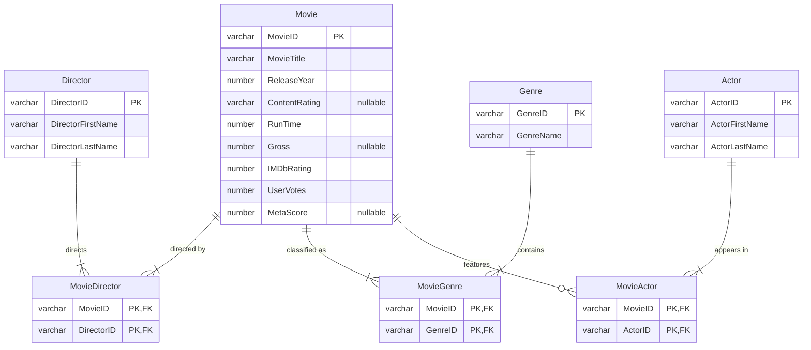

# IMDb Movie Database: Streaming Catalog Analysis

A relational database built from the IMDb Top 1000 movies, designed to help a streaming service decide **which titles are worth licensing**. A flat 16-column CSV was normalized into a 7-table Oracle schema (3NF), then queried to answer 10 catalog-acquisition questions.

**Course:** UB MGS 613, Database Management Systems (team of 5) &nbsp;·&nbsp; **Stack:** Oracle SQL, Oracle APEX

## The business problem

Licensing rights are expensive, so a streaming service needs evidence about which movies, directors, actors and genres actually draw audiences. This database combines audience ratings (IMDb), critic scores (Metacritic) and box-office gross so those questions can be answered with SQL instead of guesswork.

## Data model

Movies have many genres and many actors, so both relationships go through associative tables with composite primary keys.

## From flat file to schema

The source is a single denormalized CSV ([IMDb Dataset of Top 1000 Movies](https://www.kaggle.com/datasets/harshitshankhdhar/imdb-dataset-of-top-1000-movies-and-tv-shows), Kaggle). Cleaning before load:

- Generated a surrogate `MovieID` primary key for every title
- Converted runtime text (`"142 min"`) to integer minutes and stripped commas from gross revenue
- Kept missing Certificate, Metascore and Gross as `NULL` rather than zero, so averages and sums aren't distorted
- Corrected or removed invalid release-year values
- Split comma-separated genre lists into one row per movie–genre pair
- De-duplicated directors, actors and genres so each is stored once; trimmed whitespace and standardized name capitalization

## Questions answered

| # | Question | Finding |
|---|---|---|
| 1 | Which directors have the highest total gross? | Spielberg leads (≈ $2.48B), followed by Russo, Nolan, Cameron and Jackson |
| 2 | Which movies beat the Crime-genre average rating? | Led by *The Shawshank Redemption* (9.3); five titles rated 9.0+ |
| 3 | Highest-grossing movies rated above 8.0? | *Avengers: Endgame* tops the list at ≈ $858M |
| 4 | Highest-rated movies since 2000? | *The Dark Knight* (9.0); all top 10 are rated 8.5+ |
| 5 | Which genres gross the most? | Adventure, Drama, Action, Comedy, Sci-Fi |
| 6 | Top 5 earners inside each of those genres? | Per-genre shortlist for acquisition |
| 7 | Which actors' movies gross the most? | Robert Downey Jr. leads at ≈ $3.13B |
| 8 | Who directs the most 8.0+ movies? | Scorsese, Nolan and Spielberg tie at 7 each |
| 9 | Who directs the most 90+ Metascore movies? | Spielberg with 4; no one else has more than 2 |
| 10 | Which genre has the most 8.0+ movies? | Drama, with 278 titles |

**Takeaway for a catalog team:** Spielberg is the only director at or tied for #1 on box office, audience ratings *and* critic scores, which makes his catalog the lowest-risk licensing bet. Drama offers the deepest pool of highly rated titles to choose from.

All queries are in [`sql/02_analysis_queries.sql`](sql/02_analysis_queries.sql).

## What I'd change

Reviewing the results after the course turned up issues I'd fix in a second version:

- **A data-quality bug in the source.** For co-directed films the dataset puts the second director in the first actor slot. That's why Joe Russo appears among the top-grossing *actors* with exactly the same total as Anthony Russo, and why the "one director per movie" rule doesn't hold. A load-time check against the director list would catch it.
- **Genre totals double-count.** A movie tagged Action *and* Adventure adds its full gross to both, so Q5 ranks genres correctly but its totals add up to more than the real box office.
- **`Star1`–`Star4` duplicate `MovieActor`.** Billing order belongs in a `BillingOrder` column on `MovieActor`, not four repeating columns on `Movie`.
- **Business rules weren't enforced.** Rating range, non-negative gross and minimum votes should be `CHECK` constraints. Also a character-encoding issue on import (e.g. "Cuarón") should be fixed by loading as UTF-8.

[`sql/03_improvements.sql`](sql/03_improvements.sql) adds the constraints, rewrites Q6 as a single query with a window function (instead of five copies), and groups Q7 by `ActorID` so two people with the same name can't merge.

## Run it

Works on any Oracle 12c+ database, including a free [Oracle APEX](https://apex.oracle.com) workspace:

1. Run [`sql/01_create_tables.sql`](sql/01_create_tables.sql) to create the schema (includes one example movie across every table)
2. Load the cleaned Kaggle CSV into the tables
3. Run the queries in [`sql/02_analysis_queries.sql`](sql/02_analysis_queries.sql)
