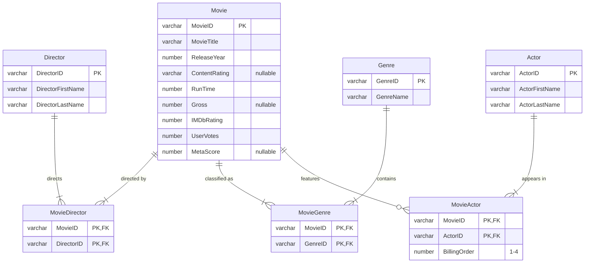

# IMDb Movie Database: Streaming Catalog Analysis

A relational database built from the IMDb Top 1000 movies, designed to help a streaming service decide **which titles are worth licensing**. A flat 16-column CSV was normalized into a 7-table Oracle schema (3NF), then queried to answer 10 catalog-acquisition questions.

**Course:** UB MGS 613, Database Management Systems (team of 5; schema and cleaning refined after the course) &nbsp;·&nbsp; **Stack:** Oracle SQL, Oracle APEX

## The business problem

Licensing rights are expensive, so a streaming service needs evidence about which movies, directors, actors and genres actually draw audiences. This database combines audience ratings (IMDb), critic scores (Metacritic) and box-office gross so those questions can be answered with SQL instead of guesswork.

## Data model

Movies can have several directors, genres and actors, so each relationship goes through an associative table with a composite primary key. Because one movie can count toward several genres, genre-level gross totals overlap: Q5 uses them to rank genres, not to measure total box office.

## From flat file to schema

The source is a single denormalized CSV ([IMDb Dataset of Top 1000 Movies](https://www.kaggle.com/datasets/harshitshankhdhar/imdb-dataset-of-top-1000-movies-and-tv-shows), Kaggle). Cleaning and validation:

- Generated a surrogate `MovieID` primary key for every title
- Converted runtime text (`"142 min"`) to integer minutes and stripped commas from gross revenue
- Kept missing Certificate, Metascore and Gross as `NULL` rather than zero, so averages and sums aren't distorted
- Corrected or removed invalid release-year values
- Split comma-separated genre lists into one row per movie–genre pair
- De-duplicated directors, actors and genres so each is stored once; trimmed whitespace and standardized name capitalization
- Loaded the CSV as UTF-8 so accented names like Alfonso Cuarón import correctly, with a check that no garbled characters remain
- Replaced the four repeating `Star1`–`Star4` columns with a `BillingOrder` column on `MovieActor`
- Caught co-directors stored as actors: for co-directed films the source puts the second director in the first actor slot, which made Joe Russo show up as a top-grossing *actor*. A validation step flags first-billed "actors" who share a surname with the film's director (the Russos, the Coens) and moves them into `MovieDirector`
- Enforced the business rules in the schema with `CHECK` constraints: rating between 0 and 10, non-negative gross, at least one vote

The checks and fixes are in [`sql/02_data_quality_checks.sql`](sql/02_data_quality_checks.sql).

## Questions answered

| # | Question | Finding |
|---|---|---|
| 1 | Which directors have the highest total gross? | Spielberg (≈ $2.48B), then the Russo brothers (≈ $2.21B each), Nolan and Cameron |
| 2 | Which movies beat the Crime-genre average rating? | Led by *The Shawshank Redemption* (9.3); five titles rated 9.0+ |
| 3 | Highest-grossing movies rated above 8.0? | *Avengers: Endgame* tops the list at ≈ $858M |
| 4 | Highest-rated movies since 2000? | *The Dark Knight* (9.0); all top 10 are rated 8.5+ |
| 5 | Which genres gross the most? | Adventure, Drama, Action, Comedy, Sci-Fi |
| 6 | Top 5 earners inside each of those genres? | Per-genre shortlist, ranked in one query with a window function |
| 7 | Which actors' movies gross the most? | Robert Downey Jr. leads at ≈ $3.13B |
| 8 | Who directs the most 8.0+ movies? | Scorsese, Nolan and Spielberg tie at 7 each |
| 9 | Who directs the most 90+ Metascore movies? | Spielberg with 4; no one else has more than 2 |
| 10 | Which genre has the most 8.0+ movies? | Drama, with 278 titles |

**Takeaway for a catalog team:** Spielberg is the only director who leads on all three measures: #1 in box office, #1 in 90+ Metascore films, and tied with Scorsese and Nolan for the most 8.0+ IMDb films. That makes his catalog the lowest-risk licensing bet. Drama offers the deepest pool of highly rated titles to choose from.

All queries are in [`sql/03_analysis_queries.sql`](sql/03_analysis_queries.sql).

## Run it

Works on any Oracle 12c+ database, including a free [Oracle APEX](https://apex.oracle.com) workspace:

1. Run [`sql/01_create_tables.sql`](sql/01_create_tables.sql) to create the schema (with one example movie across every table)
2. Load the cleaned Kaggle CSV (as UTF-8) into the tables
3. Run [`sql/02_data_quality_checks.sql`](sql/02_data_quality_checks.sql) to validate and fix the load
4. Run the queries in [`sql/03_analysis_queries.sql`](sql/03_analysis_queries.sql)
